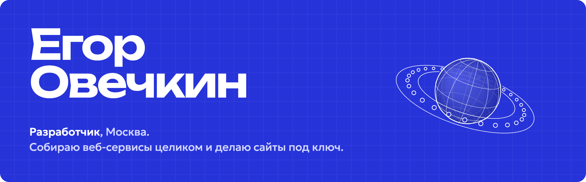
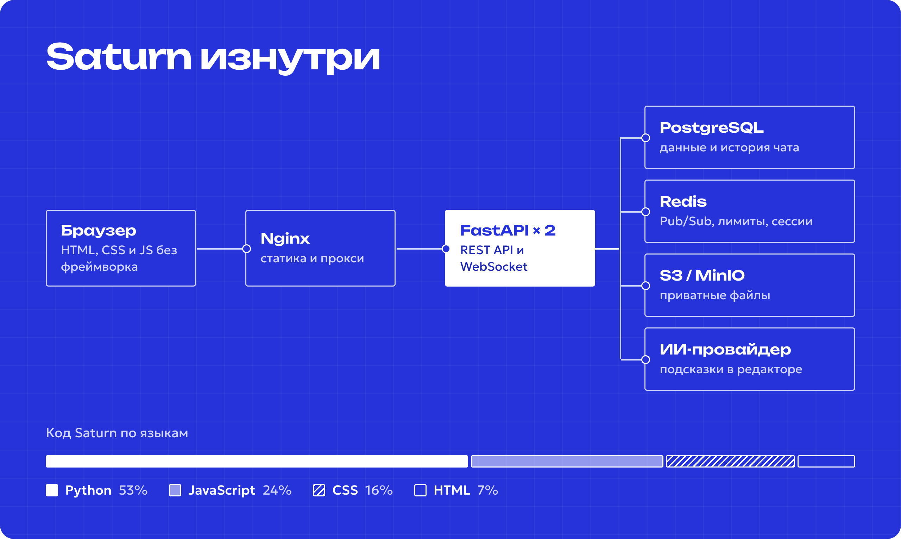
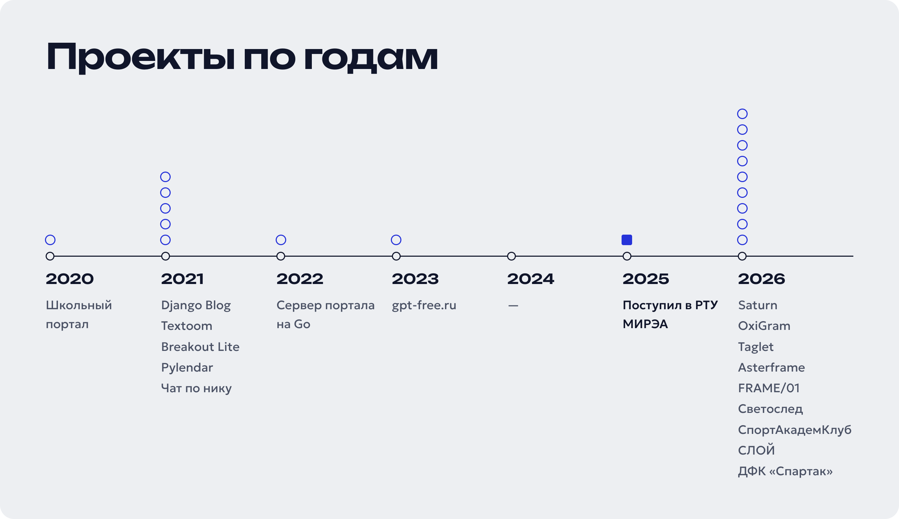

  

  <a href="https://egkodin.github.io/resume/"> Резюме</a>&nbsp;&nbsp;&nbsp;&nbsp;
  <a href="https://t.me/egor_kodin"> Telegram</a>&nbsp;&nbsp;&nbsp;&nbsp;
  <a href="mailto:egor.coden@mail.ru"> egor.coden@mail.ru</a>

Живу в Москве, учусь на бакалавриате с 2025 года. Собираю веб-сервисы целиком: схема базы, API, чат в реальном времени, тесты, запуск в Docker. Ищу стажировку или первую работу.

## Проекты

| Проект | Что это |
|:--|:--|
| [**Saturn**](https://github.com/egkodin/saturn) | Рабочее пространство для совместного написания текстов. Чат работает на двух экземплярах backend через Redis Pub/Sub, ИИ-правки применяются к актуальной ревизии документа, миграции и браузерные тесты проверяются в CI.    |
| [**Taglet**](https://github.com/egkodin/taglet) | Настольный редактор тегов MP3 без webview. Перед первой записью сохраняет резервную копию файла.    &nbsp;egui |
| **OxiGram** | Клиент Telegram для macOS в ранней разработке. Привязки к API генерируются из схемы TDLib. Код закрыт.    &nbsp;TDLib, GPUI |
| [**Asterframe**](https://github.com/egkodin/asterframe) | Инструкции для ИИ-агентов, которые пишут интерфейсы: 29 команд для дизайна и аудита и 44 автоматических правила.    |

  

## Сайты на заказ

Делаю сайты под ключ: структура, дизайн, адаптивная вёрстка, публикация на домене.

- [СпортАкадемКлуб](https://cfc-sportacadem.ru/), детский футбольный клуб в Москве
- [ДФК «Спартак» Снегири](https://egkodin.github.io/spartak-snegiri/), детская футбольная секция

  

